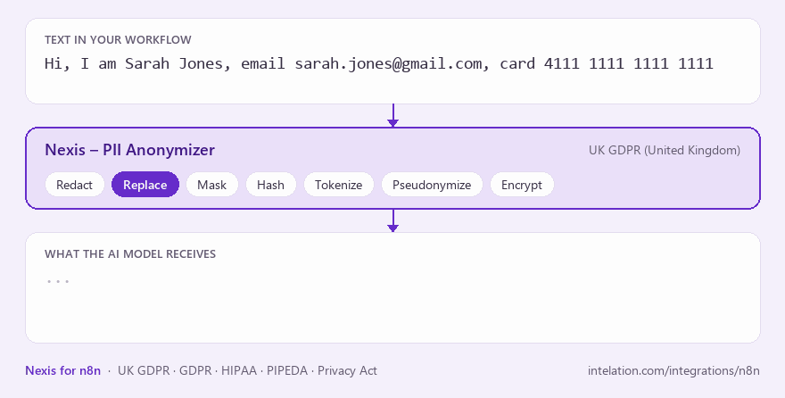

# n8n-nodes-nexis

[](https://www.npmjs.com/package/n8n-nodes-nexis)
[](LICENSE.md)

**Strip personal data before it reaches ChatGPT, your CRM or a third party.**

The Nexis node finds names, emails, card numbers, health and ID numbers in text, then redacts, masks, hashes, tokenizes, pseudonymizes or encrypts them. Or it just reports what it found, without changing the text. Detection follows the regulation you choose: UK GDPR, GDPR, HIPAA, PIPEDA, or the Privacy Acts of Australia and New Zealand. Built on [Nexis](https://www.intelation.com/integrations/n8n?utm_source=n8n&utm_medium=readme) by Intelation.



## Why Nexis

- **Regulation-aware.** Pick a country and regulation and Nexis looks for the personal data it covers, including local IDs such as NHS and National Insurance numbers (UK), Social Security and medical record numbers (US), and Steuer-ID and Personalausweis numbers (Germany).
- **Reversible when you need it.** Encrypt personal data before an AI step, then restore it afterwards with your own key.
- **Not stored by default.** Nexis returns the result to your workflow and does not keep the text you send.

## Quick start

1. Get a **free Nexis API key**: [sign up](https://nexis.intelation.com/signup?utm_source=n8n&utm_medium=readme) for free.
2. In n8n, add the **Nexis – PII Anonymizer** node and create a **Nexis API** credential with your key.
3. Pick a **Country – Regulation**, choose a method, and map your text, e.g. `{{ $json.message }}`.
4. Read the cleaned text from `anonymised_text`, and the number of items found from `pii_entity_count`.

Full guide: [intelation.com/integrations/n8n](https://www.intelation.com/integrations/n8n?utm_source=n8n&utm_medium=readme)

## What you can build

- **Privacy guard for AI prompts:** encrypt personal data before a prompt reaches the model, then decrypt the reply.
- **Support tickets to AI triage:** replace customer details with labels before an AI model classifies or drafts replies.
- **Personal data gate:** run **Detect PII** on form or webhook submissions and route the ones that contain personal data for review, using `pii_entity_count`.
- **Patient notes for research:** swap names, record numbers and dates for realistic fake values under HIPAA.
- **Anonymous candidate screening:** remove names and contact details before applications reach an AI screener.
- **Safe exports:** hash or tokenize identifiers before records go to a partner or an analytics tool.

## Anonymization methods

Same input, each method:

| Method | Output | Reversible |
|---|---|---|
| Redact | `Hi, I am [REDACTED], email [REDACTED], card [REDACTED]` | No |
| Replace | `Hi, I am <PERSON>, email <EMAIL_ADDRESS>, card <CREDIT_CARD>` | No |
| Mask | `Hi, I am ***********, email *********************, card *******************` | No |
| Hash | `Hi, I am eb721e58b3, email 4e756ee5d9, card 6a7e0e79b0` | No |
| Tokenization | `Hi, I am ENTITY_001, email ENTITY_002, card ENTITY_003` | No |
| Pseudonymization | `Hi, I am Daniel Hughes, email daniel.hughes@example.org, card 5425 2334 3010 9903` (fake values) | No |
| Encryption | `Hi, I am <<ENC:gAAAA...:ENC>>, email <<ENC:gAAAA...:ENC>>, card <<ENC:gAAAA...:ENC>>` | Yes, with **Decrypt Text** and the same key |

- **Mask** can mask only part of each value, from the start or the end, with any masking character.
- **Hash** is the first 10 characters of the SHA-256 digest, so the same value always gives the same hash.
- **Tokenization** and **Pseudonymization** are consistent within one request. Nexis does not keep the mapping, so they cannot be reversed.

## Supported regulations

| Regulation | Country | Examples of what Nexis detects |
|---|---|---|
| UK GDPR | United Kingdom | NHS number, National Insurance number, sort code and bank account, passport and driving licence numbers |
| GDPR | Germany (English and German text) | Steuer-ID, social security number, identity card and passport numbers, IBAN, vehicle registration |
| HIPAA | United States | Social Security number, medical record number, health plan ID, provider ID, drug codes |
| PIPEDA | Canada | Social Insurance Number, provincial health card number, bank account, passport and driver's licence numbers |
| Privacy Act | Australia | Tax File Number, Medicare number, ABN and ACN, passport and driver licence numbers |
| Privacy Act | New Zealand | IRD number, National Health Index (NHI) number, bank account, passport and driver licence numbers |

Every regulation also covers common personal data such as names, emails, phone numbers, card numbers, dates of birth, addresses and IP addresses. The node lists only the regulations in your Nexis plan.

## Your data

- **What leaves n8n:** only the text you map into the node and the settings you chose, sent over HTTPS to the Nexis API.
- **Where it runs:** in the EU. Nexis runs entirely on Google Cloud in Belgium (`europe-west1`), including text processing and account and usage records.
- **What Nexis keeps:** by default, not the text you send and not the result. Nexis records the counts and types of personal data found, plus usage for billing and your audit log.
- **Your encryption key:** saved as an n8n credential and sent with each Encryption or Decrypt request. Nexis does not store it.
- **Detection is not perfect.** Unusual or malformed values can be missed. Check `pii_entity_count` in your workflow, and add values you always want hidden to the deny list.

## Nexis and the Guardrails node

They do different jobs, so many workflows use both. The n8n **Guardrails** node checks AI inputs and outputs for issues such as jailbreak attempts and off-topic content. **Nexis** focuses on personal data: regulation-specific detection, seven anonymization methods, allow and deny lists, and reversible encryption.

## Plans

The free plan covers text anonymization with one regulation, which is enough to build and test your workflows. Paid plans add volume, more regulations, more users and document processing. See [plans](https://www.intelation.com/pricing?utm_source=n8n&utm_medium=readme).

## Operations

The node has three operations: **Anonymize Text**, **Detect PII** and **Decrypt Text**.

### Anonymize Text

| Setting | What it does |
|---|---|
| Country – Regulation | Which country and regulation decide what counts as personal data. Lists the countries in your Nexis plan. To set it with an expression, use an ID in the format `regulation\|country\|sub-region\|language` (sub-region and language can be empty). Pick a country from the list, then switch to Expression to see its exact ID. |
| Text | The text to process. |
| Anonymization Method | Mask, Redact, Replace, Hash, Tokenization, Encryption or Pseudonymization. |
| Encryption Key | Only for Encryption. Set in a separate **Nexis Encryption Key API** credential, which appears when you choose Encryption. A Fernet key (44-character URL-safe base64). Keep it safe: it is needed to decrypt. |
| Masking Options | For Mask: masking character, number of characters to mask, and whether to mask from the end. |
| Detection | Auto (all entities in the country), Selected Entities Only, or Exclude Entities. |
| Allow and Deny Lists | Values to always keep (allow) or always anonymize (deny). Comma or new-line separated, case-insensitive. |

**Output:** the Nexis response. Use `anonymised_text` for the cleaned text and `pii_entity_count` for the number of personal data items found.

If your plan does not include the chosen country, the node says so and how to add it.

### Detect PII

Finds personal data and lists each match, without changing the text. Use it to check text before it goes somewhere, or to route items that contain personal data.

| Setting | What it does |
|---|---|
| Country – Regulation | Same as for Anonymize Text. |
| Text | The text to scan, up to 5,000 characters per item. Longer text is rejected without calling Nexis. |
| Detection | Auto (all entities in the country), Selected Entities Only, or Exclude Entities. |
| Include Explanations | Also return why each value was or was not flagged. |

**Output:** the Nexis response:

- `pii_entity_count`: number of personal data items found.
- `detected_entities`: count per type, e.g. `{ "PERSON": 1, "EMAIL_ADDRESS": 1 }`.
- `detections`: each match, with its `entity` type, the matched `text`, its `start` and `end` position in the text, and a confidence `score`.
- `characters_scanned`: length of the text.

Nexis does not store the text or the matches.

### Decrypt Text

Restores the values encrypted by the **Encryption** method. Each encrypted value looks like `<<ENC:...:ENC>>`, and the rest of the text is left as it is.

| Setting | What it does |
|---|---|
| Encrypted Text | Text produced by the Encryption method. |
| Encryption Key | The **Nexis Encryption Key API** credential that holds the same key used to encrypt the text. |

**Output:** the Nexis response. Use `decrypted_text` for the restored text.

If the key does not match, Nexis cannot decrypt the values, and the node reports which values were left encrypted. Text with no encrypted values is rejected without calling Nexis.

### Use with AI agents

The node can be connected as a tool for the **AI Agent** node, e.g. to redact personal data before text is sent to an LLM. On self-hosted n8n, community nodes can only be used as tools when `N8N_COMMUNITY_PACKAGES_ALLOW_TOOL_USAGE=true` is set.

For the encrypt-then-restore pattern, ask the model to keep the `<<ENC:...:ENC>>` markers unchanged in its answer, then pass the answer to **Decrypt Text**.

## Installation

An n8n instance **owner or admin** installs community nodes. Once installed, everyone on the instance can use it.

**Self-hosted n8n:** go to **Settings → Community Nodes → Install**, enter `n8n-nodes-nexis`, and accept the prompt. See the [n8n community nodes guide](https://docs.n8n.io/integrations/community-nodes/installation/).

**n8n Cloud:** verification by n8n is in progress. Until it is complete, call the Nexis API from an **HTTP Request** node:

- Method `POST`, URL `https://api.nexis.intelation.com/api/text/`
- Authentication: Header Auth, name `Authorization`, value `Bearer YOUR_API_KEY`
- Body (JSON), using a regulation and country in your plan:

```json
{
  "text": {{ JSON.stringify($json.message) }},
  "regulation": "UK GDPR",
  "country": "United Kingdom",
  "language": "en",
  "anonymisation_method": "redact"
}
```

**Docker (custom image):** n8n 3.0 is Docker-only and does not load unverified community nodes installed from npm. Until this node is verified, bake it into your own image:

```dockerfile
FROM docker.n8n.io/n8nio/n8n
USER root
RUN mkdir -p /home/node/.n8n/nodes && cd /home/node/.n8n/nodes \
    && npm install n8n-nodes-nexis \
    && chown -R node:node /home/node/.n8n
USER node
```

**Compatibility:** built and tested against n8n 2.x (`n8n-workflow` 2.16). Requires Node.js 22 or higher for development.

## Credentials

1. [Sign up for Nexis](https://nexis.intelation.com/signup?utm_source=n8n&utm_medium=readme) (free plan available) and create a key in the dashboard under **API Integration**.
2. In n8n, add a **Nexis API** credential and paste the key. It is sent as `Authorization: Bearer <key>`.
3. **Base URL** defaults to `https://api.nexis.intelation.com`. Change it only for a dedicated or on-premises instance.
4. Click **Test** to check the connection.

**Nexis Encryption Key API** is a second, separate credential, used only by the Encryption method and by Decrypt Text. It holds a Fernet key, which you can generate with either command:

```bash
node -e "console.log(require('crypto').randomBytes(32).toString('base64url') + '=')"
```

```bash
python -c "from cryptography.fernet import Fernet; print(Fernet.generate_key().decode())"
```

Keep the key safe. Nexis does not store it, and without it encrypted values cannot be recovered.

## FAQ

**Will it catch every piece of personal data?** No detection tool is perfect. Check `pii_entity_count`, use the deny list for values you always want hidden, and review high-risk flows.

**Can I get the original data back?** Only with the Encryption method, using Decrypt Text and the same key. All other methods are one-way.

**Can I run Nexis inside my own network?** Yes, Nexis can run as a dedicated or on-premises instance. Set the credential's Base URL to it and [contact us](https://www.intelation.com/contact?utm_source=n8n&utm_medium=readme).

## Development

```bash
npm install
npm run dev     # n8n with the node loaded, hot reload
npm run lint
npm run build
npm test        # unit tests, no network calls
```

## Support

- Guide: [intelation.com/integrations/n8n](https://www.intelation.com/integrations/n8n?utm_source=n8n&utm_medium=readme)
- Product and API: [nexis.intelation.com](https://nexis.intelation.com/?utm_source=n8n&utm_medium=readme)
- Help: email [support@intelation.com](mailto:support@intelation.com), or use the support form in the Nexis dashboard.
- Security issues: see [SECURITY.md](SECURITY.md).

## License

MIT, see [LICENSE.md](LICENSE.md).
